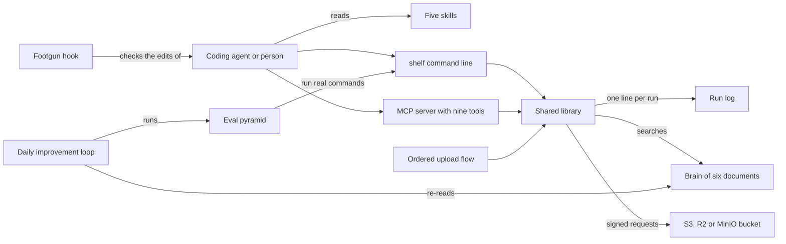

# How Shelf works

Shelf handles the file side of an app: uploads, object storage and safe serving. It is for coding agents, and the people who drive them, whenever an app accepts, stores or serves user files. It mints presigned uploads, checks each file's real type and estimates the storage bill. A presigned URL is a short-lived link, signed with your storage keys, that allows one upload or one download. Shelf comes as a command line tool, an MCP server and five skills. MCP (Model Context Protocol) is a standard way for an agent to call tools.

## The parts



An agent reaches Shelf in three ways. The [skills](../skills/) tell it when to act and which command to call. The command line starts in [src/index.ts](../src/index.ts), with one file per command in [src/commands/](../src/commands/). The MCP server in [src/mcp/server.ts](../src/mcp/server.ts) offers nine tools over stdio, or over HTTP when `SHELF_MCP_HTTP` is set. Both surfaces call the same library in [src/lib/](../src/lib/), so an agent gets the same answer however it asks. [src/dispatch/upload-flow.ts](../src/dispatch/upload-flow.ts) runs an upload as five ordered stages that a test can check.

The library does the real work. [src/lib/presigner.ts](../src/lib/presigner.ts) picks the bucket and signs requests. [src/lib/validate.ts](../src/lib/validate.ts) checks magic bytes, the first bytes of a file that reveal its real type. [src/lib/brain.ts](../src/lib/brain.ts) and [scripts/brain-search.mjs](../scripts/brain-search.mjs) search the six documents in [brain/](../brain/) with BM25, a standard keyword ranking. [src/lib/observability.ts](../src/lib/observability.ts) appends one line per run to a log in [logs/](../logs/). The hook in [hooks/block-storage-footguns.js](../hooks/block-storage-footguns.js) blocks four unsafe storage patterns in an agent's edits. The evals in [eval/](../eval/) run real commands, and [workflows/rsi.workflow.js](../workflows/rsi.workflow.js) runs them every day.

## What happens when you run it

The main flow is `shelf upload photo.png --bucket demo`.

1. [src/index.ts](../src/index.ts) parses the command line and hands over to [src/commands/upload.ts](../src/commands/upload.ts).
2. `withRun` in [src/lib/observability.ts](../src/lib/observability.ts) starts a trace id and a timer for the run.
3. The command reads the file and checks it with [src/lib/validate.ts](../src/lib/validate.ts). A fake type, an oversize file or an SVG stops the run before any network call.
4. `resolveTarget` in [src/lib/presigner.ts](../src/lib/presigner.ts) picks the bucket. It tries `S3_ENDPOINT` first, then the R2 keys, then the AWS keys.
5. [src/lib/keys.ts](../src/lib/keys.ts) makes a random key under `incoming/`, unless you pass `--key`.
6. `presignPost` in [src/lib/presigner.ts](../src/lib/presigner.ts) signs a POST policy that caps the size. The signing happens on your machine.
7. The command posts the file straight to the bucket.
8. A HEAD request reads the stored size. If the object is too big, Shelf deletes it and exits with an error.
9. [src/lib/output.ts](../src/lib/output.ts) prints the result, or JSON with `--json`. The run log gains one line.

`shelf get` reads the object back through a short-lived signed URL, in [src/commands/get.ts](../src/commands/get.ts). [src/dispatch/upload-flow.ts](../src/dispatch/upload-flow.ts) runs the same path as five stages: presign, upload, head, validate and confirm. Its validate stage downloads the stored bytes and checks them again. [src/dispatch/upload-flow.test.ts](../src/dispatch/upload-flow.test.ts) asserts that order.

## Extending it

- **A command.** Add a file in [src/commands/](../src/commands/) that exports a `register` function, like [src/commands/cost.ts](../src/commands/cost.ts). Register it in [src/index.ts](../src/index.ts). Put shared logic in [src/lib/](../src/lib/) so the MCP server can reuse it. Add the name to `EXPECTED_COMMANDS` in [eval/l1-structural.test.ts](../eval/l1-structural.test.ts) and to the command table in [AGENTS.md](../AGENTS.md).
- **An MCP tool.** Call `server.registerTool` inside `buildServer` in [src/mcp/server.ts](../src/mcp/server.ts). Describe the inputs with zod and call the same library function the command uses.
- **A skill.** Add `skills/<name>/SKILL.md` with a `name`, a `description` and a `trigger` in its front matter. Copy the shape of [skills/presign-upload/SKILL.md](../skills/presign-upload/SKILL.md).
- **An eval.** Add a golden task to [eval/golden/](../eval/golden/), shaped like [eval/golden/GT-01.json](../eval/golden/GT-01.json). Each check runs a real `shelf` command and asserts its exit code and the text it must or must not print. Point the task at a scenario id in [brain/BATTLE-TESTED-SCENARIOS.md](../brain/BATTLE-TESTED-SCENARIOS.md).
- **Expertise.** Add a scenario, pitfall or opinion to the matching document in [brain/](../brain/), with its id in the heading. `shelf brain` searches it and `shelf explain <id>` prints it.
- **A guard rail.** Add a pattern to [hooks/block-storage-footguns.js](../hooks/block-storage-footguns.js). The hook exits with code 2 on a finding and 0 on clean input.

Then run `pnpm build && pnpm test && pnpm eval`. CI runs the same checks on every push. A round trip against MinIO, a local S3-compatible server, gates the merge in [.github/workflows/acceptance.yml](../.github/workflows/acceptance.yml). A change that lowers an eval score is not merged.

## Questions

**Does it need an API key or cost money?**
It needs no model API key. Most commands run offline at no cost. Only upload, get, cors check and the lifecycle commands reach a bucket, and your storage provider bills for that. A local MinIO server set in `S3_ENDPOINT` costs nothing. The optional sandbox boot in [sandbox/boot.mjs](../sandbox/boot.mjs) uses `E2B_API_KEY` if you set it. Without the key it runs the same checks on your machine.

**Does any data leave the machine?**
Only when a command reaches a bucket, and then only to the bucket you configured. Presigning happens locally. The run log stays in [logs/](../logs/). The local page in [web/](../web/) listens on 127.0.0.1 only and never uploads. With `E2B_API_KEY` set, the sandbox boot installs the command line in an E2B cloud microVM, a small virtual machine, and runs it there.

**How does it improve itself?**
Its self-improvement contract, [dsip.json](../dsip.json), names one level, `agent`, a nightly loop and `noSelfGrading: true`. [.github/workflows/rsi.yml](../.github/workflows/rsi.yml) runs [workflows/rsi.workflow.js](../workflows/rsi.workflow.js) every day at 07:33 UTC. The loop re-indexes the brain and compares prices and tool status with [workflows/snapshots/tool-matrix.json](../workflows/snapshots/tool-matrix.json). Then it runs the evals and writes a proposal. It never commits. A person turns a proposal into a change, and lessons become rules in [memory/LEARNINGS.md](../memory/LEARNINGS.md).

**How do I run its tests or checks?**

```bash
pnpm install && pnpm build
pnpm test          # unit and structural tests, with vitest
pnpm eval          # structure, the 14 golden tasks, then a rule-based judge checked against hand labels
pnpm rsi           # one pass of the improvement loop, which never commits
S3_ENDPOINT=http://localhost:9000 pnpm test:acceptance   # the round trip against a local MinIO
```

**What does it not do?**
It ships no sign-in, no upload screen and no database module. It does not rate-limit requests or charge customers. It does not drive a browser. The local page in [web/](../web/) only reads: it never presigns against a live bucket, uploads or touches keys.
